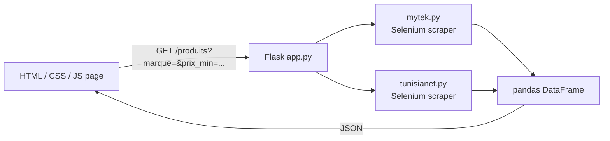

<div align="center">

# 💻 Laptop Price Scraper — MyTek & Tunisianet

**A Flask web app that scrapes laptop listings from two Tunisian electronics retailers, merges them, and lets you filter by brand, processor and price.**


</div>

---

## What it does

Comparing laptop prices across shops means opening several sites and filters. This app queries **MyTek** and **Tunisianet** on demand, normalises the results into one table (name, price, availability, image, link, source) and shows them side by side in a single page.

## Features

- Filters: **brand**, **processor**, **minimum price**, **maximum price**
- Live scraping with Selenium and `undetected-chromedriver`, one scraper per site (`mytek.py`, `tunisianet.py`)
- Results merged with pandas and served as JSON to the page (AJAX)
- Product cards with image, price, stock status, source and purchase link
- Clear "no product found" state

## Architecture



## Getting started

**Prerequisites:** Python 3.10+ and Google Chrome installed.

```bash
git clone https://github.com/atef-hadef/scrape_mytek_tunisianet.git
cd scrape_mytek_tunisianet
python -m venv .venv && source .venv/bin/activate     # Windows: .venv\Scripts\activate
pip install -r requirements.txt
python app.py
```

Open the address printed by Flask (by default `http://127.0.0.1:5000`), choose at least one filter and search.

## Project structure

```
.
├── app.py                  Flask server and /produits endpoint
├── mytek.py                MyTek scraper
├── tunisianet.py           Tunisianet scraper
├── templates/index.html    page
├── static/style.css        styles
├── produits_mytek.csv      sample scraped output
└── produit_tunisianet.csv  sample scraped output
```

## Notes

- Scrapers depend on the shops' current HTML and will need updating if the sites change.
- Check each site's terms of use and keep request rates reasonable.
- Ideas: cache results, schedule scraping, add price-history charts.

## Author

**Atef Ben Hadef**: [GitHub](https://github.com/atef-hadef) · [LinkedIn](https://linkedin.com/in/atef-ben-hadef)
